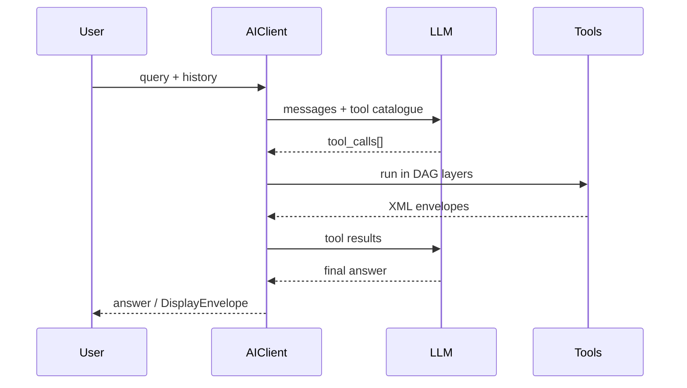

# Using AIClient

The `AIClient` orchestrates the dance between:

1. Your **conversation history** (stateless, caller-managed).
2. One or more **XMCP servers** exposing tools.
3. One or more **LLM providers** (OpenAI, Anthropic, local models).



---

## Minimal Setup

```python
providers = [OpenAIProvider(model_id="gpt-4o")]
async with AIClient(urls=["http://localhost:3333"], providers=providers) as ai:
    history = []
    res = await ai.chat("What is 2 + 2?", history)
    print(res["answer"])
```

### Streaming

```python
async for chunk in ai.stream_chat("Show sales as a chart", history):
    if chunk.type == "llm_delta":
        ui.append_text(chunk.text)
    elif chunk.type == "tool_display":
        ui.render(chunk.envelope)
```

### Hot-Reload

```python
aiclient = AIClient(urls=[...], providers=[...], refresh_interval=300)
# ... later
await aiclient.refresh_tools()
```

### Caching

```python
from xmcp.client.cache import RedisCache
ai = AIClient(urls=[...], providers=[...], cache=RedisCache(ttl=300))
```

---

## Dependency Graph Execution

When the LLM requests multiple tools in the same turn, `AIClient` executes them **layer-by-layer** based on the `depends_on` annotation.

```python
@mcp.tool()
def a(): ...
@mcp.tool(depends_on=["a"])
def b(): ...
@mcp.tool(depends_on=["b"])
def c(): ...
```

`AIClient` derives: `[[a], [b], [c]]`.

---

## Meta-Tools

| Name | Purpose |
|------|---------|
| `__think__` | Record hidden chain-of-thought. |
| `__summarize__` | Compress history to save tokens. |
| `__clarify__` | Ask the user a follow-up question and **return early**. |

These are injected automatically; you don't have to expose them on the server.

---

## Error & Display Callbacks

```python
def on_error(err, hist):
    log.error("tool failed", err)

aiclient = AIClient(urls=[...], providers=[...], on_error=on_error)
```

```python
def on_display(env, hist):
    ui.render(env)
```

---

## Concurrency & Timeouts

```python
aiclient = AIClient(
    urls=[...], providers=[...],
    max_concurrency=10,
    tool_timeout=8.0,
    retry_policy={"max_attempts": 3, "backoff_base": 0.5},
)
```

---

## Manual Loop

Sometimes you need **full control** over the agentic loop – for instance when
embedding the assistant inside a GUI, a voice-assistant or a multi-step
workflow engine.  The low-level helpers introduced in v0.3 let you drive the
conversation *one turn at a time* while re-using all the heavy lifting done by
`AIClient` (tool registry, dependency graph, caching, …).

### Minimal CLI Demo

```python
import asyncio
from seqoria_agent.client import AIClient
from seqoria_agent.providers import OpenAIProvider

async def main():
    providers = [OpenAIProvider(model_id="gpt-4o")]
    async with AIClient(urls=["http://localhost:3333"], providers=providers) as ai:
        history: list[dict] = []

        while True:
            user_query = input("You: ")
            if not user_query:
                break  # Exit on empty line

            # 1) Add system + user message
            ai.prepare_history(user_query, history)

            # 2) Let the model decide on a single step
            resp = await ai.llm_generate_once(history)
            ai.append_assistant_message(resp.text, history, tool_calls=resp.tool_calls)

            # 3) Execute tools (if any) and let early-exit bubble up
            if resp.tool_calls:
                early = await ai.run_tool_calls(resp.tool_calls, history)
                if early and early.get("answer"):
                    print(f"Assistant: {early['answer']}")
                    continue

            print(f"Assistant: {resp.text}")

if __name__ == "__main__":
    asyncio.run(main())
```

### Streaming UI Integration

`llm_stream_once()` yields incremental *deltas* followed by the full
`LLMResponse`.  Combine it with your favourite framework to render tokens in
real-time:

```python
async for chunk in ai.llm_stream_once(history):
    if isinstance(chunk, str):
        ui.append_token(chunk)  # ← progressive rendering
    else:
        ai.append_assistant_message(chunk.text, history, tool_calls=chunk.tool_calls)
```

### Debugging Tips

* Enable **verbose logging** via `LOGLEVEL=DEBUG` to see tool graphs and cache
  hits.
* Register `on_display`, `on_error`, or `on_metadata` callbacks when
  constructing the client to intercept structured events.
* Call `await ai.refresh_tools()` to hot-reload the tool catalogue without
  recreating the client object.

``` 