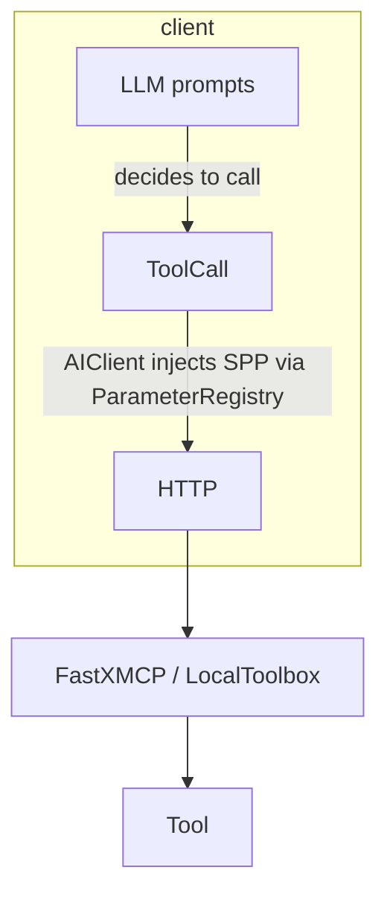

# Migrating to Server-Populated Parameters **v2**

> **Breaking change – released in 0.4.0**
>
> The `ParameterProvider` protocol has been **removed**.  Replace it with the
> new dict-based `ParameterRegistry`.

## TL;DR

Old code:
```python
client = AIClient(
    ..., 
    param_providers=[DemoUserProvider()],
)
```

New code:
```python
from seqoria_agent.client.parameters import ParameterRegistry

client = AIClient(
    ..., 
    param_registry=ParameterRegistry({
        "user_id": lambda tenant_id: f"{tenant_id}:anonymous",
    }),
)
```

## Side-by-side diff
```diff
- param_providers=[DemoUserProvider()],
+ param_registry=ParameterRegistry({
+     "user_id": lambda tenant_id: f"{tenant_id}:anonymous",
+ }),
```

## How it works



1. The tool declares `server_populated=["user_id"]`.
2. AIClient sees `user_id` is missing in the outgoing request.
3. It asks `ParameterRegistry.resolve("user_id", context)`.
4. The resolved value is sent **only** via the `serverArgs` channel; the LLM
   never sees it.

## Writing callables

Only keyword arguments that appear in the callable signature are forwarded –
this keeps call-sites declarative and future-proof.

```python
async def provide_user_id(tenant_id: str, history):
    ...
```

## Deprecation / runtime guard

Passing the removed `param_providers=` kwarg now raises:
```
TypeError: param_providers removed; use param_registry
```

---
For the complete roadmap see `docs/migration/spp_update.md`. 