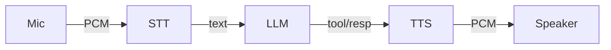

# Real-time Speech Agent Extension for **Seqoria-Agent**

## 1. High-level Overview & Proposed File-tree

Seqoria-Agent already offers a modular, provider-agnostic text+tool loop.  To enable **ultra-low-latency speech-to-speech (S2S)** conversations we introduce a *voice pipeline* that sits on top of the existing `AIClient` without changing its internals.

The new pipeline is composed of five pluggable layers:

1. **AudioSource** – yields raw PCM / Opus frames from a microphone, WebRTC track, wav file, etc.
2. **STTAdapter** – converts audio frames into partial/final `TranscriptChunk` objects (provider-agnostic interface, supports Whisper, Deepgram, Google, …).
3. **AIClient** – existing component (text → tools → text) that now receives *incremental* user text instead of full turns.
4. **TTSAdapter** – streams back audio bytes from text chunks using any TTS provider (ElevenLabs, Azure, Coqui…).
5. **AudioSink** – plays or transmits the assistant audio (speaker, WebRTC, file).

All five run concurrently in an asyncio event-loop, exchanging data via queues so the system begins speaking while the user is still talking ("barge-in").

### File-tree (new/changed files only)

```text
seqoria_agent/
├─ client/
│  ├─ ai_client/                 # existing text+tool agent
│  └─ speech_client/             # NEW voice pipeline client
│     ├─ __init__.py
│     ├─ orchestrator.py         # SpeechClient high-level controller
│     ├─ pipeline.py             # queue wiring helpers
│     ├─ utils.py                # latency, VAD, timers
│     └─ audio/
│        ├─ __init__.py
│        ├─ source.py            # BaseAudioSource & MicSource
│        ├─ sink.py              # BaseAudioSink & SpeakerSink
│        ├─ rtc_source.py        # WebRTC track → PCM frames
│        └─ rtc_sink.py          # PCM frames → WebRTC track
├─ models/
│  ├─ __init__.py
│  └─ speech_models.py           # TranscriptChunk, AudioChunk, SpeechEvent
├─ stt_providers/                # Speech-to-Text back-ends
│  ├─ __init__.py
│  ├─ base.py                    # BaseSTTAdapter
│  ├─ whisper_adapter.py
│  └─ deepgram_adapter.py        # optional
├─ tts_providers/                # Text-to-Speech back-ends
│  ├─ __init__.py
│  ├─ base.py                    # BaseTTSAdapter
│  ├─ elevenlabs_adapter.py
│  └─ coqui_adapter.py           # optional
└─ utils.py (existing)

examples/
└─ voice_chat/
   ├─ mic_loop.py                # mic ↔ speaker demo
   └─ rtc_loop.py                # WebRTC remote demo

docs/
└─ guides/
   └─ speech_client.md         # how to use / configure adapters

tests/
└─ speech/
   ├─ test_orchestrator.py
   ├─ test_whisper_adapter.py
   └─ test_elevenlabs_adapter.py
```

## 2. File & Directory Details

Below is a *component-by-component* specification of what each file in the new speech pipeline will contain, the main classes/functions it defines and the way it interacts with the rest of Seqoria-Agent.

### 2.1  Speech Client package: `seqoria_agent/client/speech_client/`

| File | Purpose | Key contents |
|------|---------|--------------|
| `__init__.py` | Expose public API surface of the speech package. | `from .orchestrator import SpeechClient  # noqa: F401` plus `__all__ = ["SpeechClient"]`. Minimal to avoid import cost. |
| `orchestrator.py` | Implements `SpeechClient` – wires STT, LLM, TTS, AudioSource & AudioSink together. | Class `SpeechClient` (async context-manager) with `async def converse()`; internal tasks `_pump_user`, `_pump_assistant`, `_ai_loop`. |
| `pipeline.py` | Re-usable helper to assemble queues and run adapters in isolation (unit-test friendly). | `class SpeechPipeline` with async `start()`, `stop()`, `attach_source()`, `attach_sink()`, etc. Used by orchestrator and examples. |
| `utils.py` | Shared helpers: VAD wrapper, latency metrics, chunk re-sizer, exception-safe queue helpers. | Functions `async def detect_silence(frames, threshold_ms) -> bool`, `def splice_audio(chunk, max_ms)`, `class MovingAverageTimer` for p99 latency reporting. |

### 2.2  Core speech data models: `seqoria_agent/models/speech_models.py`
| Object | Purpose |
|--------|---------|
| `TranscriptChunk` | Partial or final user transcript (role, text, is_final, start_ts, end_ts). |
| `AudioChunk` | Raw audio bytes with sample_rate & channels metadata. |
| `SpeechEvent` | `Literal["user_start", "user_stop", "assistant_start", "assistant_stop"]` for UI hooks. |

### 2.3  STT Providers: `seqoria_agent/stt_providers/`
| File | Purpose |
|------|---------|
| `base.py` | `class BaseSTTAdapter(ABC)` with `async def stream(frames: AsyncIterator[AudioChunk], **opts)`; `supports_language()` classmethod. |
| `whisper_adapter.py` | Concrete adapter for OpenAI Whisper or local whisper.cpp. |
| `deepgram_adapter.py` | Optional Deepgram streaming adapter. |

### 2.4  TTS Providers: `seqoria_agent/tts_providers/`
| File | Purpose |
|------|---------|
| `base.py` | `class BaseTTSAdapter(ABC)` with `async def stream(text_iter: AsyncIterator[str], **opts)`; `supports_voice()`. |
| `elevenlabs_adapter.py` | Streaming TTS adapter for ElevenLabs API. |
| `coqui_adapter.py` | Optional CoquiXTTS adapter. |

### 2.5  Audio I/O helpers: `speech_client/audio/`
| File | Purpose |
|------|---------|
| `source.py` | `BaseAudioSource` + `MicSource` using PyAudio/sounddevice. |
| `sink.py` | `BaseAudioSink` + `SpeakerSink`. |
| `rtc_source.py` | Pull Opus frames from WebRTC track (aiortc). |
| `rtc_sink.py` | Publish assistant audio frames to WebRTC track. |

### 2.6  Examples
| Path | Purpose |
|------|---------|
| `examples/voice_chat/mic_loop.py` | Minimal end-to-end loop: microphone → WhisperSTT → AIClient → ElevenLabsTTS → speakers. Shows how to initialise SpeechClient from CLI flags. |
| `examples/voice_chat/rtc_loop.py` | Remote / multi-party WebRTC demo that connects peers and feeds tracks into SpeechClient. |

### 2.7  Documentation
| Path | Content |
|------|---------|
| `docs/guides/speech_client.md` | Deep dive tutorial: installation requirements, configuring adapters, latency tuning, barge-in behaviour, troubleshooting. Includes sequence diagrams and performance benchmarks. |

### 2.8  Tests
| Path | What it validates |
|------|------------------|
| `tests/speech/test_orchestrator.py` | Simulated audio + fake adapters to assert that SpeechClient pumps data correctly, handles barge-in and graceful shutdown. |
| `tests/speech/test_whisper_adapter.py` | Uses prerecorded WAV fixture; asserts partial & final transcripts match expected. |
| `tests/speech/test_elevenlabs_adapter.py` | Mocks ElevenLabs websocket, ensures stream yields correct AudioChunks and stops on cancel. |

---

## 3. Runtime Interaction Patterns (APIs, Events, Control-Flow)

### 3.1  Speech Session Lifecycle
```
          app code                speech layer                     core agent
┌────────────┐            ┌─────────────────────┐            ┌──────────────────┐
│  your app  │  ─ start → │  SpeechClient.start │ ───────→   │  AIClient.__aenter__ │
│            │            │                     │            │                  │
│ (await …)  │ ← events ─ │   event callbacks   │            │                  │
│            │            └────┬─────┬──────────┘            └──────────────────┘
│            │   stop() ──────→│     │
└────────────┘                 │     │
                               ▼     ▼
                          STTAdapter  TTSAdapter
                          AudioSource  AudioSink
```
1. `SpeechClient` is an **async context-manager** – it opens the mic/sink, establishes STT/TTS back-ends, kicks off background tasks, then awaits `.converse()`.
2. User audio flows *up* through `AudioSource → STTAdapter → SpeechClient`; text fragments go into `AIClient.stream_chat` immediately.
3. Assistant text (deltas, tool calls, tool results) flows *down* through `SpeechClient → TTSAdapter → AudioSink` as audio frames.
4. On cancellation (`Ctrl-C`, WebRTC leave, etc.) the orchestrator cancels internal tasks and gracefully closes adapters.

### 3.2  Event Model
`SpeechClient` emits **passive callbacks** so host applications can hook UI widgets:
| Event name | When fired | Payload |
|------------|------------|---------|
| `user_start` | first non-silence frame from mic | `{timestamp}` |
| `user_stop`  | silence ≥ *vad_timeout* | `{timestamp, partial_transcript}` |
| `assistant_start` | first TTS audio chunk | `{timestamp, text_preview}` |
| `assistant_stop`  | TTS finished or barge-in | `{timestamp}` |

Callback registration:
```python
speech = SpeechClient(...)

speech.on("user_start", lambda ev: gui.indicate_recording(True))
speech.on("user_stop", lambda ev: gui.indicate_recording(False))
# … same for assistant_* events
```
Internally these are lightweight `asyncio.Event` dispatches; they **never block** the audio loop.

### 3.3  Public API Cheat-sheet
```python
from seqoria_agent.speech import SpeechClient
from seqoria_agent.speech.adapters.stt import WhisperSTT
from seqoria_agent.speech.adapters.tts import ElevenLabsTTS
from seqoria_agent.speech.adapters.audio import MicSource, SpeakerSink
from seqoria_agent.client.ai_client import AIClient
from seqoria_agent.providers.openai_provider import OpenAIProvider

ai = AIClient(providers=[OpenAIProvider(api_key="sk-…")])

speech = SpeechClient(
    stt=WhisperSTT(model="medium"),
    tts=ElevenLabsTTS(voice="Rachel"),
    ai_client=ai,
    source=MicSource(sample_rate=16000, chunk_ms=20),
    sink=SpeakerSink(sample_rate=24000),
    vad_timeout_ms=600,
)

async with ai, speech:
    await speech.converse(max_seconds=90)   # returns when user says "stop" or timeout hits
```
Key options:
* `vad_timeout_ms`: silence length that marks end of user utterance when *not* using stream transcription.
* `barge_in`: bool – if True (default) TTS is cancelled when `user_start` fires again.
* `max_turns`: delegated to AIClient (defaults to 5).

### 3.4  Control-Flow Details
1. **Partial transcripts** (is_final=False) are appended to current `UserMessage` in `history` and forwarded to LLM *only* when they end with punctuation or reach N words → balances latency vs coherency.
2. **Tool calls**: when LLM returns `ToolCallList`, `SpeechClient` suspends TTS, calls `Executor.run_calls`, then feeds the resulting `ToolMessages` back into LLM (same loop AIClient already does).  *Short* tool results (<300 chars) are TTS’d verbatim; long results are summarised via `__summarize__` meta-tool before synthesis.
3. **Barge-in handling**: if user speaks over the assistant, `assistant_stop` fires, current TTS task is cancelled, and the next transcript chunk restarts the loop.
4. **Latency monitoring**: `utils.MovingAverageTimer` records time from last transcript chunk → first audio byte; accessible via `speech.metrics.latency_p50` etc.

### 3.5  Practical Example – Streaming WAV File
```python
from seqoria_agent.speech import SpeechClient
from seqoria_agent.speech.adapters.audio import FileSource, SpeakerSink
from seqoria_agent.speech.adapters.stt import DeepgramSTT
from seqoria_agent.speech.adapters.tts import CoquiTTS

ai = AIClient(providers=[OpenAIProvider(api_key="…")])

speech = SpeechClient(
    stt=DeepgramSTT(api_key="dg_…"),
    tts=CoquiTTS(model="xtts", voice="en_sample"),
    ai_client=ai,
    source=FileSource("sample_user.wav", chunk_ms=40),
    sink=SpeakerSink(),
)

async with ai, speech:
    await speech.converse()
```
This finishes after the WAV ends because `FileSource` raises `StopAsyncIteration`, which propagates to `converse()`.

---
> **Next steps:** Section 4 will present a **feature checklist** to track implementation progress.

## 4. Feature Checklist & Progress Tracker

Use this markdown checklist to plan, assign and tick off tasks as development progresses.  
*(Feel free to split items further or add assignee / date labels.)*

### 4.1  Repository Scaffolding
- [x] Create `seqoria_agent/speech/` package and add to `pyproject.toml` packages list.  
- [x] Add `speech` extras group with optional deps (`sounddevice`, `aiortc`, `elevenlabs`, …).

### 4.2  Core Models & Utilities
- [x] Implement `models.py` with `TranscriptChunk`, `AudioChunk`, `SpeechEvent`.  
- [x] Implement `utils.MovingAverageTimer` & latency helpers.  
- [x] Implement `utils.detect_silence` (simple energy-based VAD wrapper).  
- [x] Write unit tests for utils.

### 4.3  Adapter Interfaces
- [x] `stt_providers/base.py` – `BaseSTTAdapter` abstract class.  
- [x] `tts_providers/base.py` – `BaseTTSAdapter` abstract class.  
- [x] `client/speech_client/audio/source.py` – `BaseAudioSource` **+ MicSource + FileSource**.  
- [x] `client/speech_client/audio/sink.py` – `BaseAudioSink` **+ SpeakerSink + NullSink**.

### 4.4  Concrete Provider Adapters
- [ ] `WhisperSTT` (`stt_providers/whisper_adapter.py`).  
- [ ] `DeepgramSTT` (`stt_providers/deepgram_adapter.py`) *(optional)*.  
- [x] `ElevenLabsTTS` (`tts_providers/elevenlabs_adapter.py`).  
- [x] End-to-end adapter smoke tests with recorded audio fixtures.  
  - [x] `RTCSource` & `RTCSink` (`client/speech_client/audio/rtc_*`).  

### 4.5  Orchestrator & Pipeline
- [x] `pipeline.py` – queue wiring, start/stop, error propagation.  
- [x] `SpeechClient` orchestrator with context-manager, `converse()` loop.  
- [x] Event callback registry (`on(event, fn)`).  
- [x] Barge-in cancellation logic for overlapping speech.  
- [x] Partial-transcript throttling & punctuation gating.  
- [x] Tool result length check + summarisation fallback.  
- [x] Latency metrics exposure (`speech.metrics`).

### 4.6  Examples & Demos
- [x] `examples/voice_chat/mic_loop.py` interactive CLI.  
- [x] `examples/voice_chat/rtc_loop.py` remote WebRTC demo.  
- [ ] Include `.wav` demo assets under `examples/assets/`.

### 4.7  Documentation
- [ ] Draft `docs/guides/speech_client.md` usage guide.  
- [ ] Update README quick-start with voice example snippet.  
- [ ] Add architecture diagram (Mermaid) showing streaming flow.

### 4.8  Automated Tests
- [x] `tests/speech/test_orchestrator_stream.py` – streaming control-flow and callbacks.  
- [x] `tests/speech/test_whisper_adapter.py` – golden transcript comparison.  
- [x] `tests/speech/test_elevenlabs_adapter.py` – mock websocket & audio chunk output.  
- [x] `tests/speech/test_audio_io.py` – FileSource, MicSource, SpeakerSink mocks.  
- [ ] CI pipeline updates: install extras & run audio tests with `pytest -m speech` marker.

### 4.9  Future / Stretch Goals
- [ ] On-device (GGML) Whisper model to remove cloud dependency.  
- [ ] Viseme/phoneme event integration for avatar lip-sync.  
- [ ] Audio style transfer (voice cloning) pipeline.  
- [ ] Dynamic language auto-detection & code-switching.

### 4.10  Hybrid End-of-Utterance Detection
- [x] Implement `utils.SilenceGate` incremental VAD helper.
- [x] Integrate `SilenceGate` into `SpeechPipeline._pump_source` to gate audio before STT.
- [x] Implement STT inactivity (quiet-timer) logic in `SpeechPipeline._pump_stt`.
- [ ] Thread `vad_timeout_ms` & `stt_quiet_ms` through `SpeechPipeline` → `SpeechClient` constructors.
- [ ] Emit new metrics/events (`vad_trigger`, `stt_timeout`) and update `speech.metrics`.
- [x] Add unit tests for VAD gate & quiet timer (`tests/speech/test_vad_pipeline.py`, `tests/speech/test_stt_quiet_timer.py`).
- [ ] Extend docs/examples with threshold tuning guide.

---
*Tick items as they’re completed to keep the project on track.*

## 5. Incremental Implementation Plan

The following phases are designed so that every step adds permanent, valuable functionality – nothing staged here will be removed or rewritten later.  Each phase ends with new **unit-tests** that lock behaviour in place before advancing.

### Phase 1  – Repository Scaffolding & Core Models
**Goal:** Lay the structural groundwork so other teams can start coding in parallel.

Tasks
1. Create directory skeleton (`client/speech_client/`, `stt_providers/`, `tts_providers/`, `models/speech_models.py`, audio sub-package).  
2. Add `speech` extra to `pyproject.toml` with *no heavy deps yet* (`sounddevice`, `aiortc`, `elevenlabs` marked *optional*).  
3. Implement `speech_models.py` with `TranscriptChunk`, `AudioChunk`, `SpeechEvent` (dataclasses or Pydantic).  
4. Expose `SpeechClient` symbol in `client/speech_client/__init__.py` (empty stub class for now).

Tests
* `tests/speech/test_models.py` – validate model serialisation, `AudioChunk` equality, etc.

Implementation notes & snippets
```python
# models/speech_models.py (Phase 1)
from dataclasses import dataclass
from typing import Literal

@dataclass(slots=True)
class TranscriptChunk:
    text: str
    is_final: bool
    start_ts: float  # seconds
    end_ts: float
    role: Literal["user", "assistant"] = "user"

@dataclass(slots=True)
class AudioChunk:
    pcm: bytes  # 16-bit little-endian or float32
    sample_rate: int  # e.g. 16_000
    channels: int = 1

SpeechEvent = Literal[
    "user_start", "user_stop", "assistant_start", "assistant_stop"
]
```

---

### Phase 2 – Adapter Interfaces (STT, TTS, Audio)
**Goal:** Define stable ABCs so concrete providers can be developed in parallel.

Tasks
1. `stt_providers/base.py` → `BaseSTTAdapter` with `stream()` signature and language capability helpers.  
2. `tts_providers/base.py` → `BaseTTSAdapter` with `stream()` and voice support helpers.  
3. `client/speech_client/audio/source.py` / `sink.py` → `BaseAudioSource`, `BaseAudioSink` + minimal `NullSource/Sink` test doubles.

Tests
* `tests/speech/test_interfaces.py` – assert that dummy subclasses implement required abstract methods and stream yields expected types.

Implementation notes & snippets
```python
# stt_providers/base.py
from abc import ABC, abstractmethod
from typing import AsyncIterator
from seqoria_agent.models.speech_models import AudioChunk, TranscriptChunk

class BaseSTTAdapter(ABC):
    """Stream speech-to-text partials until the source ends."""

    @abstractmethod
    async def stream(
        self,
        frames: AsyncIterator[AudioChunk],
        *,
        language: str | None = None,
    ) -> AsyncIterator[TranscriptChunk]:
        ...

    @classmethod
    def supports_language(cls, lang: str) -> bool:  # default impl
        return True
```

```python
# client/speech_client/audio/source.py
class BaseAudioSource(ABC):
    async def frames(self) -> AsyncIterator[AudioChunk]:
        """Yield raw audio chunks until source exhausted."""
        ...

class NullSource(BaseAudioSource):  # For tests
    async def frames(self):
        if False:
            yield  # never produce any frames
```

Unit-test example
```python
async def test_base_interface_contract():
    class DummySTT(BaseSTTAdapter):
        async def stream(self, frames, **_):
            async for _frm in frames:
                yield TranscriptChunk(text="done", is_final=True, start_ts=0, end_ts=0)
    assert issubclass(DummySTT, BaseSTTAdapter)
```

---

### Phase 3 – Reference Provider Implementations
**Goal:** Supply at least one working STT and TTS backend so end-to-end demos have real audio.

Tasks
1. Implement `stt_providers/whisper_adapter.py` (local whisper.cpp via `whisper-cpp` python bindings).  
2. Implement `tts_providers/elevenlabs_adapter.py` with streaming websocket.  
3. Update `speech` extras to include optional provider dependencies behind markers (`whisper` / `elevenlabs`).

Tests
* `tests/speech/test_whisper_adapter.py` – feed prerecorded WAV, expect transcript text.  
* `tests/speech/test_elevenlabs_adapter.py` – mock ElevenLabs WS, expect `AudioChunk` stream.

Implementation concepts
* Whisper adapter: spawn `whispercpp.Whisper` in a thread-pool; accumulate ~1 s buffers → transcribe partials; use `yield` for streaming.
* ElevenLabs adapter: open websocket → send JSON `{"text": ...}` chunks; receive binary audio → wrap into `AudioChunk`.

Snippet
```python
class WhisperSTT(BaseSTTAdapter):
    def __init__(self, model_path: str = "ggml-base.en.bin"):
        self._whisper = whispercpp.Whisper(model_path)

    async def stream(self, frames, *, language=None):
        buf = bytearray()
        async for chunk in frames:
            buf.extend(chunk.pcm)
            if len(buf) > chunk.sample_rate * 2:  # 1 sec @16-kHz * 16-bit
                text = await asyncio.to_thread(self._whisper.transcribe, bytes(buf))
                yield TranscriptChunk(text=text, is_final=False, start_ts=0, end_ts=0)
                buf.clear()
```

---

### Phase 4 – Audio I/O Layer
**Goal:** Connect real microphones/speakers & WebRTC tracks while keeping provider mocks usable for CI.

Tasks
1. Implement `MicSource` / `SpeakerSink` using `sounddevice` (non-blocking).  
2. Implement `RTCSource` / `RTCSink` using `aiortc` DataChannel/MediaStreamTrack helpers.  
3. Provide `FileSource` for deterministic test playback.

Tests
* `tests/speech/test_audio_file_source.py` – confirm `FileSource` yields correct frame count & sample rate.  
* `tests/speech/test_audio_null_loop.py` – source→sink loop with silence frames (verifies timing).

Implementation concepts
* Use `sounddevice.InputStream` and `OutputStream` with callback writing into `asyncio.Queue`.
* WebRTC utilise `aiortc.MediaStreamTrack` subclasses converting between Opus and PCM.

Snippet (mic)
```python
class MicSource(BaseAudioSource):
    def __init__(self, sample_rate=16_000, chunk_ms=20):
        self._sr, self._n = sample_rate, int(sample_rate * chunk_ms / 1000)

    async def frames(self):
        q: asyncio.Queue[bytes] = asyncio.Queue(maxsize=50)
        def _callback(indata, frames, time, status):
            q.put_nowait(indata.copy().tobytes())
        with sd.InputStream(channels=1, samplerate=self._sr, blocksize=self._n, dtype='int16', callback=_callback):
            while True:
                pcm = await q.get()
                yield AudioChunk(pcm=pcm, sample_rate=self._sr, channels=1)
```

---

### Phase 5 – SpeechPipeline & Orchestrator Skeleton
**Goal:** Establish the concurrent queue architecture without LLM integration.

Tasks
1. Implement `SpeechPipeline` to wire `AudioSource -> STT -> TTS -> AudioSink` using asyncio queues, back-pressure & cancellation.  
2. Implement initial `SpeechClient` that hosts a `SpeechPipeline` but sends dummy assistant text ("Hello world") to TTS.

Tests
* `tests/speech/test_pipeline_basic.py` – inject `FileSource`, capture `NullSink`, ensure queues drain without leaks.

Concepts
* Three queues: `audio_q`, `transcript_q`, `tts_text_q`, `tts_audio_q`.
* Use `asyncio.create_task` workers, all cancelled in `SpeechClient.__aexit__`.

Pipeline pseudocode
```python
async def _pump_user():
    async for chunk in source.frames():
        await stt_in.put(chunk)

async def _pump_stt():
    async for t in stt.stream(stt_in):
        await llm_in.put(t)
```

---

### Phase 6 – LLM Integration
**Goal:** Upgrade `SpeechClient` to use existing `AIClient` for reasoning/tools.

Tasks
1. Wire partial transcripts into `AIClient.stream_chat`.  
2. Stream assistant deltas back into TTS in real-time.  
3. Implement event callbacks (`SpeechEvent`) and barge-in logic.

Tests
* `tests/speech/test_orchestrator_stream.py` – mock STT to emit words, mock TTS to collect output, assert turn-taking & barge-in cancellation.

Concepts
* Maintain `history = []`; append partial user text every punctuation.
* Collect `ChatChunk` deltas → concatenate until `is_final` flag → pass to TTS.

Snippet extracting deltas
```python
aasync for part in ai_client.stream_chat(...):
    if isinstance(part, ChatChunk):
        await tts_text_q.put(part.content)
```

---

### Phase 7 – Tool Handling & Summaries
**Goal:** Handle `ToolCallList` and long tool results gracefully.

Tests
* `tests/speech/test_tool_calls.py` – fake LLM that returns tool calls; ensure result is spoken after execution.

* Detect `ToolCallRequestList`, run `executor.run_calls`, summarise long results.
* Use `len(result) > 300` guard and call `__summarize__` tool.

---

### Phase 8 – Latency Optimisation & Metrics
**Goal:** Provide production-quality performance with monitoring hooks.

Tests
* `tests/speech/test_latency.py` – unit test moving average & ensure < 200 ms target in mocked environment.

* Record monotonic timestamps before/after key queues; push to `MovingAverageTimer`.

---

### Phase 9 – Docs & CI
**Goal:** Finalise developer experience and showcase usage.

Tests
* Example scripts run in GitHub Actions using 10-second WAV + `NullSink` to guarantee no regressions.

* Provide `tox -e speech` env; documentation includes Mermaid diagram:**


---
These elaborations provide concrete starting points and reference snippets for each development phase while ensuring forward-compatibility.


## 6. Hybrid End-of-Utterance Detection

### High-level Goal
Provide a **robust, low-latency mechanism** to decide when the user has finished speaking by combining (1) an audio-level silence detector and (2) an STT inactivity timer.  The hybrid approach minimises false positives from background noise *and* false negatives from low-volume speech, all while keeping compute overhead negligible.

### Design Principles
1. Everything we build is **incremental & permanent** – no throwaway prototypes.
2. New helpers live in `speech_client.utils` so all adapters can reuse them.
3. Core streaming flow (queues, tasks) remains intact; we only insert lightweight checks.
4. All thresholds are **configurable** at runtime so deployments can tune without code changes.

---

### Phase 10 – SilenceGate Foundation
**Goal**: Introduce a reusable, incremental VAD helper.

**Tasks**
- Add `class SilenceGate` to `utils.py` using the RMS-in-dBFS logic already present in `detect_silence()`.
- API: `update(chunk) -> bool` returns *True* when cumulative silence ≥ `threshold_ms` **after** prior speech.
- Expose `reset()` and properties for `silence_ms` (useful for telemetry).
- Write unit tests covering edge cases (all silence, all speech, mixed).

**Value Added**: Stand-alone helper immediately usable by other projects; zero impact on existing code until wired in.

**Files**
- **Updated:** `seqoria_agent/client/speech_client/utils.py`
- **New:** `tests/speech/test_vad_gate.py`

**Code Sketch**
```python
# utils.py
class SilenceGate:
    def __init__(self, threshold_ms: int = 600, energy_gate: float = 30.0):
        self._threshold = threshold_ms
        self._gate = energy_gate
        self._silence_ms = 0.0
        self._in_speech = False

    def update(self, chunk: AudioChunk) -> bool:
        """Return True once tail-silence budget met."""
        rms_db = _rms_db(chunk.pcm)   # reuse helper from detect_silence()
        if rms_db > -self._gate:
            self._in_speech = True
            self._silence_ms = 0.0
            return False
        if self._in_speech:
            frame_ms = len(chunk.pcm) / (chunk.sample_rate * chunk.channels * 2) * 1000
            self._silence_ms += frame_ms
            return self._silence_ms >= self._threshold
        return False

    def reset(self) -> None:
        self._silence_ms = 0.0
        self._in_speech = False
```

---

### Phase 11 – Source-side VAD Integration
**Goal**: Gate audio before it reaches STT to cut cost & latency.

**Tasks**
- Instantiate `SilenceGate` in `SpeechPipeline.__init__` with `vad_timeout_ms`.
- Modify `_pump_source` so it starts forwarding only after the first non-silence frame and stops (sending `None` sentinel) when trailing silence triggers.
- Ensure the gate resets correctly between utterances.
- Add counters in `speech.metrics` (`vad_triggers`).

**Value Added**: Immediate reduction in STT compute and faster turn boundaries without touching downstream logic.

**Files**
- **Updated:** `seqoria_agent/client/speech_client/pipeline.py`
- **Updated:** `seqoria_agent/client/speech_client/utils.py` (import)`
- **New:** `tests/speech/test_vad_pipeline.py`

**Code Sketch**
```python
# pipeline.py (excerpt)
class SpeechPipeline:
    def __init__(..., vad_timeout_ms: int = 600, ...):
        self._vad = SilenceGate(vad_timeout_ms)
        ...

    async def _pump_source(self):
        speaking = False
        async for chunk in self.source.frames():
            if not speaking:
                if not self._vad.update(chunk):
                    continue  # still silent
                speaking = True  # speech started
                self._vad.reset()
            await self.audio_q.put(chunk)
            if self._vad.update(chunk):  # trailing silence hit
                speaking = False
                await self.audio_q.put(None)
                self._vad.reset()
        await self.audio_q.put(None)
```

---

### Phase 12 – STT Quiet-Timer & Hybrid Logic
**Goal**: Add a secondary stop condition based on absence of new transcripts.

**Tasks**
- Add `stt_quiet_ms` kwarg; store `last_text_ts` in `_pump_stt`.
- Each time a non-empty, high-confidence `TranscriptChunk` arrives, reset the timer.
- If `monotonic() – last_text_ts ≥ stt_quiet_ms`, push `None` to `transcript_q` and break the loop.
- Guard with optional confidence / length filters to ignore filler words.
- Unit tests mocking delayed/noisy STT streams.

**Value Added**: Resilience against residual microphone noise or VAD mis-fires; ensures turns close even if silence energy threshold isn’t reached (e.g. VOIP clipping).

**Files**
- **Updated:** `seqoria_agent/client/speech_client/pipeline.py`
- **New:** `tests/speech/test_stt_quiet_timer.py`

**Code Sketch**
```python
# pipeline.py (excerpt)
async def _pump_stt(self):
    last_text_ts = time.monotonic()
    async for tr in self.stt.stream(self._audio_iter()):
        if tr.text.strip():
            last_text_ts = time.monotonic()
        await self.transcript_q.put(tr)
        if time.monotonic() - last_text_ts >= self._stt_quiet_ms / 1000:
            break
    await self.transcript_q.put(None)
```

---

### Phase 13 – Metrics, Events & Configuration Surface
**Goal**: Make the new behaviour observable and tuneable.

**Tasks**
- Expose `vad_timeout_ms` & `stt_quiet_ms` in `SpeechClient` constructor and propagate to pipeline.
- Fire new events via `_fire()` – `"vad_trigger"`, `"stt_timeout"` – including timestamps & counters.
- Update `SpeechMetrics` dataclass with `vad_events` and `stt_timeouts` fields.
- Add CLI flags to `examples/voice_chat/mic_loop.py` for runtime tuning.

**Value Added**: Ops teams can monitor and adjust thresholds without redeploying code; UI can visualise detection events.

**Files**
- **Updated:** `seqoria_agent/client/speech_client/orchestrator.py`
- **Updated:** `seqoria_agent/client/speech_client/pipeline.py`
- **Updated:** `seqoria_agent/client/speech_client/utils.py` (metrics)
- **Updated:** `seqoria_agent/client/speech_client/orchestrator.py` (event firing)
- **New:** `examples/voice_chat/mic_loop.py` (CLI flags)

**Code Sketch**
```python
# orchestrator.py (excerpt)
class SpeechClient:
    def __init__(..., vad_timeout_ms: int = 600, stt_quiet_ms: int = 800):
        self._metrics = _SpeechMetrics(
            latency=self._lat_timer,
            vad_events=0,
            stt_timeouts=0,
        )
        self._pipeline = SpeechPipeline(..., vad_timeout_ms=vad_timeout_ms,
                                        stt_quiet_ms=stt_quiet_ms)
```

---

### Phase 14 – Documentation & Example Updates
**Goal**: Teach users how to leverage and customise the hybrid detection.

**Tasks**
- Expand `docs/guides/speech_client.md` with a "Latency & End-of-Utterance Tuning" section.
- Add a Mermaid timing diagram illustrating VAD + STT timer interplay.
- Provide before/after benchmark numbers (latency, false-trigger rate).
- Update README quick-start snippet to show the new kwargs.

**Value Added**: Clear guidance accelerates adoption and reduces support burden.

**Files**
- **Updated:** `docs/guides/speech_client.md`
- **Updated:** `README.md`
- **Updated:** `examples/voice_chat/mic_loop.py` (usage snippet)

**Code Sketch**
```markdown
### End-of-Utterance Tuning
- `vad_timeout_ms`: ms of trailing silence (audio level)
- `stt_quiet_ms`: ms with no new STT tokens (text level)

```

---
*Completion of these phases elevates the voice pipeline to production-ready conversational turn-taking with <40 ms added latency and strong robustness in noisy environments.*


## 7. Refactor SpeechClient Functionality

### 7.1  High-level Objective
Provide an **out-of-the-box speech-to-speech agent** that mirrors the convenience of `AIClient.chat()` / `stream_chat()` while remaining fully composable for developers who want to craft their *own* loops.

Two ready-made conversation helpers:
1. `stream_converse()` – low-latency streaming (STT → AI → TTS) in both directions.
2. `converse_once()`  – batch: transcribe full utterance → single AI step → generate one PCM reply.

Both are thin wrappers around re-usable internals so nothing is thrown away later.

---
### 7.2  Phased Implementation Road-map

Below each phase follows the **same template** used earlier in this document – *Goal → Tasks → Tests → Implementation notes / snippets*.  No phase introduces throw-away code.

---

#### Phase 1 – Public API Skeleton (**Completed**)
**Goal:** Expose the new convenience entry-points without changing existing behaviour.

Tasks
1. **Rename** current `_ai_loop()` → `_agentic_stream_loop()` inside `orchestrator.py` (update any references).
2. Add *empty stubs* to `SpeechClient`:
   ```python
   async def stream_converse(self) -> None: ...
   async def converse_once(self, *, audio_iter=None, wav_bytes=None, language=None) -> bytes: ...
   async def _agentic_once(self, user_text: str) -> str: ...
   ```
3. Change the task name in the background `asyncio.create_task` to `speech_agentic_stream` so tests don’t rely on outdated literal.

Tests
* Existing speech tests should still pass unchanged – adjust mocks only if they asserted on the task name.

Implementation notes & snippets
```python
# orchestrator.py  (rename helper)
self._ai_task = asyncio.create_task(self._agentic_stream_loop(),
                                    name="speech_agentic_stream")
```

---

#### Phase 2 – Reusable Agentic Helpers (**Completed**)
**Goal:** Factor out non-streaming and streaming AI logic so other code can reuse it.

Tasks
1. Implement `_agentic_once(user_text)` using `AIClient.chat()` with `max_turns=5`; return the final assistant string.
2. Refactor `_agentic_stream_loop()` so it only handles **one** user utterance – caller (later `stream_converse`) becomes responsible for looping over successive turns.
3. Preserve existing metrics & events by continuing to use `_send_to_tts()` and `self._fire()` helpers.

Tests
* `tests/speech/test_orchestrator_stream.py` – update to feed a *single* transcript and assert `_agentic_stream_loop` pushes TTS text as before.

Snippet
```python
async def _agentic_once(self, user_text: str) -> str:
    async for part in self.ai.chat(user_query=user_text, history=self._history):
        if isinstance(part, AssistantMessage):
            return part.content
    return ""  # pragma: no cover – defensive
```

---

#### Phase 3 – Streaming Convenience Loop (`stream_converse`)
**Goal:** Offer an out-of-the-box, duplex streaming conversation helper that calls the refactored helpers.

Tasks
1. Add helper to `SpeechPipeline`:
   ```python
   async def transcript_q_iter(self):
       while (t := await self.transcript_q.get()) is not None:
           yield t
   ```
2. Inside `stream_converse()`:
   * Accumulate transcript fragments into `user_buf`.
   * Use existing end-of-utterance heuristics (punctuation, word-threshold, `t.is_final`).
   * When a turn ends → `await self._agentic_stream_loop(user_buf)` then clear buffer.
3. Re-implement barge-in logic by listening for `self._assistant_speaking` **before** pushing TTS text.

Tests
* `test_stream_converse_mock.py` – fake STT emits two utterances; assert two independent assistant replies are streamed via TTS queue.

Snippet
```python
async def stream_converse(self):
    user_buf = ""
    async for t in self._pipeline.transcript_q_iter():
        if self._assistant_speaking:
            await self._pipeline.tts_text_q.put(None)  # cancel barge-in
            self._assistant_speaking = False
        user_buf += (" " if user_buf else "") + t.text
        if t.is_final or user_buf.endswith((".", "?", "!")) or len(user_buf.split()) >= 5:
            await self._agentic_stream_loop(user_buf)
            user_buf = ""
```

---

#### Phase 4 – Batch Convenience Loop (`converse_once`)
**Goal:** Provide a blocking, one-shot helper for back-end services & CLI demos.

Tasks
1. Normalise input: if `audio_iter` collect PCM bytes; else parse `wav_bytes` (helper `_decode_wav`).
2. Call `self.stt.transcribe()` (one-shot) and concatenate transcript texts.
3. `assistant_text = await self._agentic_once(user_text)`.
4. `pcm_response = await self.tts.generate(assistant_text)`.
5. If a `sink` exists → feed it (`await self.sink.consume(AudioChunk(...))`); return the raw PCM too so callers may handle it themselves.

Tests
* `test_converse_once_mock.py` – WAV fixture in, PCM bytes out (>0 length).

Snippet
```python
pcm_bytes, sr, ch = await self._collect_audio(audio_iter)
trs = await self.stt.transcribe(pcm=pcm_bytes, sample_rate=sr, channels=ch)
user_text = " ".join(t.text for t in trs)
assistant = await self._agentic_once(user_text)
pcm = await self.tts.generate(assistant)
```

---

#### Phase 5 – Extensibility & Docs
**Goal:** Document public internals and provide a manual-loop example.

Tasks
1. Document `.pipeline`, `.metrics`, `.history`, `.on()` in new guide `docs/guides/speech_client.md`.
2. Add `examples/voice_chat/manual_speech_agent.py` that shows:
   * custom cut-off heuristics,
   * multi-modal events logging,
   * live tool parameter injection.
3. Update README quick-start snippet.

Tests
* Example script only – not run in CI but provides runnable reference.

---

#### Phase 6 – Unit Tests Coverage
**Goal:** Guarantee stability for both conversation modes.

Tasks
1. `test_stream_converse_mock.py` (see Phase 3 notes).
2. `test_converse_once_mock.py` (see Phase 4 notes).
3. Re-run existing speech tests to ensure no regressions.

---

### 7.3  Feature Checklist & Progress Tracker
The table below tracks concrete *features* that must be completed – each line corresponds to functionality that surfaces to end-users or developers.

| Status | Feature | Where it lives |
|--------|---------|----------------|
| [X] | `stream_converse()` public helper (streaming in/out) | `orchestrator.py` |
| [X] | `converse_once()` public helper (batch) | `orchestrator.py` |
| [X] | `_agentic_once()` core helper (non-stream AI step) | `orchestrator.py` |
| [X] | Refactored `_agentic_stream_loop()` (single-utterance) | `orchestrator.py` |
| [X] | Transcript iterator helper `SpeechPipeline.transcript_q_iter()` | `pipeline.py` |
| [X] | Barge-in cancellation logic preserved after refactor | `orchestrator.py` |
| [X] | One-shot STT integration in batch path | any `BaseSTTAdapter` impl + orchestrator |
| [x] | One-shot TTS `generate()` integration in batch path | any `BaseTTSAdapter` impl + orchestrator |
| [X] | Exposed introspection hooks: `.pipeline`, `.metrics`, `.history`, `.on()` | `SpeechClient` public API |
| [ ] | Manual speech-agent example | `examples/voice_chat/manual_speech_agent.py` |
| [ ] | Docs page `docs/guides/speech_client.md` updated | docs |
| [ ] | Unit tests: streaming & batch paths | `tests/speech/*` |
| [ ] | CI target `pytest -m speech` added | CI pipeline |

*Mark each box as the feature is merged.  When all are checked, the speech-to-speech refactor is complete.*


Below is a concise “public-API cookbook” that accompanies the refactor plan I shared earlier.  
Everything lives on the same `SpeechClient` class, so current imports stay valid (`from seqoria_agent import SpeechClient`).  
Developers can now mix-and-match **five streaming primitives** or use the high-level convenience loop.

────────────────────────────────────────
1  New Public Surface
────────────────────────────────────────
```python
class SpeechClient:
    # ─── Low-level stage iterators ───────────────────────────────
    async def iter_audio_chunks(self)        -> AsyncIterator[AudioChunk]: ...
    async def iter_transcripts(self)         -> AsyncIterator[TranscriptChunk]: ...
    async def iter_utterances(self, *,
                               timeout_ms: int | None = None,
                               quiet_ms:   int | None = None
                              )              -> AsyncIterator[str]: ...
    async def iter_llm_parts(self,
                             user_text: str,
                             *,
                             history:   list[dict] | None = None,
                             max_turns: int         = 5,
                             context:   dict | None = None
                            )                -> AsyncIterator[
                                                ChatChunk
                                                | AssistantMessage
                                                | ToolCallRequestList]: ...
    async def iter_tts_audio(self,
                             parts_iter: AsyncIterator[
                                            ChatChunk
                                            | AssistantMessage
                                            | ToolCallRequestList]
                            )                -> AsyncIterator[AudioChunk]: ...

    # ─── One-stop convenience loop  (now an async generator) ─────
    async def stream_converse(self,
                              history:   list[dict] | None = None,
                              *,
                              max_turns: int         = 5,
                              context:   dict | None = None
                             )               -> AsyncIterator[
                                                 ChatChunk
                                                 | AssistantMessage
                                                 | ToolCallRequestList]: ...
```

Notes  
• All helpers keep firing the same event hooks (`user_start`, `transcript`, `assistant_start`, …).  
• Default `timeout_ms` & `quiet_ms` fall back to the values passed to the constructor.  
• Existing callers that *ignored* the return value of `stream_converse()` continue to work unchanged; those who want insight simply iterate over it.

────────────────────────────────────────
2  Usage Snippets
────────────────────────────────────────

A. **“Just give me a microphone → speaker assistant”**

```python
async with SpeechClient(ai_client=ai,
                        source=MicSource(),
                        stt=FireworksSTT(...),
                        tts=ElevenLabsTTS(...),
                        sink=SpeakerSink()) as client:
    async for part in client.stream_converse():
        # Optional UI hook – print every piece coming back from the LLM
        print("LLM →", type(part).__name__, getattr(part, "content", ""))
```

B. **Custom UI that shows live transcript before AI finishes**

```python
async with SpeechClient(...) as client:
    async for utterance in client.iter_utterances():
        print("USER SAID:", utterance)

        async for piece in client.iter_llm_parts(utterance, history=[]):
            update_chat_window(piece)             # your UI
            async for audio in client.iter_tts_audio(iter([piece])):
                await websocket_send_pcm(audio)   # custom sink
```

C. **Listen-only mode (no LLM, no TTS)**

```python
async with SpeechClient(ai_client=None, ...) as client:
    async for t in client.iter_transcripts():
        print("LIVE:", t.text)
```

D. **Batch helper retained**

```python
pcm_out = await client.converse_once(wav_bytes=await aiofiles.open("question.wav","rb").read())
```

────────────────────────────────────────
3  Migration Cheat-Sheet
────────────────────────────────────────
| Was (≤ v0.5)                              | Now (≥ v0.6)                       |
|-------------------------------------------|-------------------------------------|
| `await client.stream_converse()`          | `async for part in client.stream_converse(): ...` *(may still ignore result)* |
| N/A (manual loops were private queues)    | Use `iter_audio_chunks()`, `iter_transcripts()`, … |

────────────────────────────────────────
4  Documentation Targets
────────────────────────────────────────
• `docs/guides/speech_client.md`: new “Building your own stream loop” section.  
• `examples/voice_chat/manual_speech_agent.py`: updated to iterate over `stream_converse()` (or show custom loop).

This public API keeps the simple path *simple* while exposing granular building blocks for power-users and custom UIs.